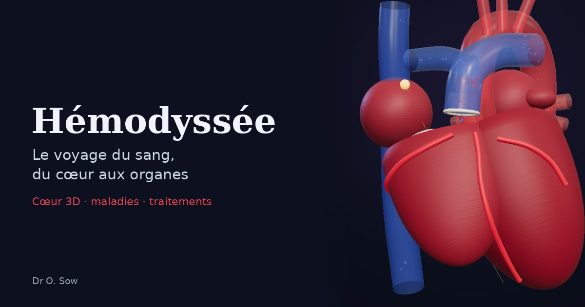

# Hémodyssée : le voyage du sang

[](https://oumarmaiil-oss.github.io/hemodyssee/)


**Outil pédagogique gratuit et ouvert** pour comprendre et faire comprendre le cœur, la circulation,
les maladies cardiovasculaires et l'effet des traitements. Fonctionne sur téléphone, tablette et
ordinateur, même hors connexion.

👉 **https://oumarmaiil-oss.github.io/hemodyssee/**



## Pour qui ?
- **Étudiants** en médecine, pharmacie, dentaire, soins infirmiers ;
- **Enseignants** et **soignants** qui expliquent une maladie ou un traitement ;
- **Patients** (niveau « Découvrir ») ;
- **Délégués médicaux** (présentations guidées, mode labo réservé).

## Ce qu'on peut faire
- **Explorer** : suivre une goutte de sang (veines caves → cœur droit → poumons → cœur gauche → aorte → organes) ; cœur 3D en coupe et en transparence, voyage du sang, corps et vaisseau en 2D.
- **Maladies** : 21 pathologies (HTA, dyslipidémie, valvulopathies, FA, BAV, infarctus, insuffisance cardiaque, AVC, maladie rénale, diabète…) avec leurs conséquences visibles.
- **Traitements** : 13 classes, à ajouter une par une (½, standard, double dose) ; effets indésirables, associations à éviter, conséquences de l'arrêt.
- **Évolution** : sans traitement, traitement suivi, traitement arrêté, sur 5 ans.
- **Présentations guidées avec voix off** (HTA, HTA non contrôlée, cholestérol, fibrillation atriale), **9 cas cliniques** corrigés, **fiche récapitulative** en PDF.
- **3 niveaux** : Découvrir, Comprendre, Approfondir. Bruits du cœur, ECG et pressions.
- **Export** photo et vidéo, partage direct sur WhatsApp.
- **Mode labo** (réservé au délégué) : ouvrir une fois l'adresse avec `?labo` à la fin ; le bouton mallette apparaît alors sur cet appareil (`?public` le retire). Gamme définie dans `src/content/labo.ts`. Le grand public ne voit jamais de marques.

## Contribuer
Projet **bêta** : erreurs médicales, bugs, idées, relectures et traductions sont les bienvenus.
- Dans l'application : bouton vert **Contact** (WhatsApp) ;
- Sur GitHub : [ouvrir une issue](https://github.com/oumarmaiil-oss/hemodyssee/issues/new/choose) ;
- Guide complet : [CONTRIBUTING.md](CONTRIBUTING.md).

```bash
npm install
npm run dev     # développement
npm test        # tests du moteur, du contenu et de la voix off
npm run lint    # typage
npm run build   # version publiée (déployée automatiquement sur GitHub Pages)
```

Organisation du code :
- `src/core` : moteur physiologique, horloge du cycle cardiaque, son, voix off (sans interface) ;
- `src/content` : tout le contenu sous forme de données (zones, pathologies, classes, présentations, cas) ;
- `src/render` : cœur 3D (three.js, chargé à la demande), voyage du sang, corps et vaisseau en 2D (canvas) ;
- `src/ui` : interface React.

## Sur quoi reposent les chiffres
Law MR et al., BMJ 2009 (effet et additivité des antihypertenseurs) ; Ettehad D et al., Lancet 2016
(risque par 10 mmHg) ; Cholesterol Treatment Trialists' Collaboration, Lancet 2010 (LDL) ;
Wolf PA et al., Stroke 1991 et Hart RG et al., Ann Intern Med 2007 (FA) ; recommandations ESC/ESH.

## Avertissement
Modèle simplifié à visée pédagogique : il montre les bons sens de variation et les bons ordres de
grandeur, pas l'évolution d'un patient réel. Il ne remplace ni l'avis médical ni le RCP des médicaments.

## Licences
- **Code** : [GNU AGPL v3](LICENSE) ;
- **Contenu pédagogique** : [CC BY-NC-SA 4.0](LICENCE-CONTENU.md) (attribution, pas d'usage commercial sans accord, partage dans les mêmes conditions).

Usage commercial, version personnalisée ou partenariat : contacter l'auteur.

## Auteur
**Dr Oumar Sow**, pharmacien, Dakar (Sénégal). WhatsApp : +221 77 414 47 99.

---

### English
**Hémodyssée** is a free, open-source educational web app (in French) to understand the heart, blood
circulation, cardiovascular diseases and how treatments work, with a 3D heart, guided presentations
with voice-over and clinical cases. Built in Dakar, Senegal. Works offline on any phone.
Code: AGPL-3.0 · Content: CC BY-NC-SA 4.0 · Contributions welcome (see [CONTRIBUTING.md](CONTRIBUTING.md)).

© 2026 Dr Oumar Sow et contributeurs.
